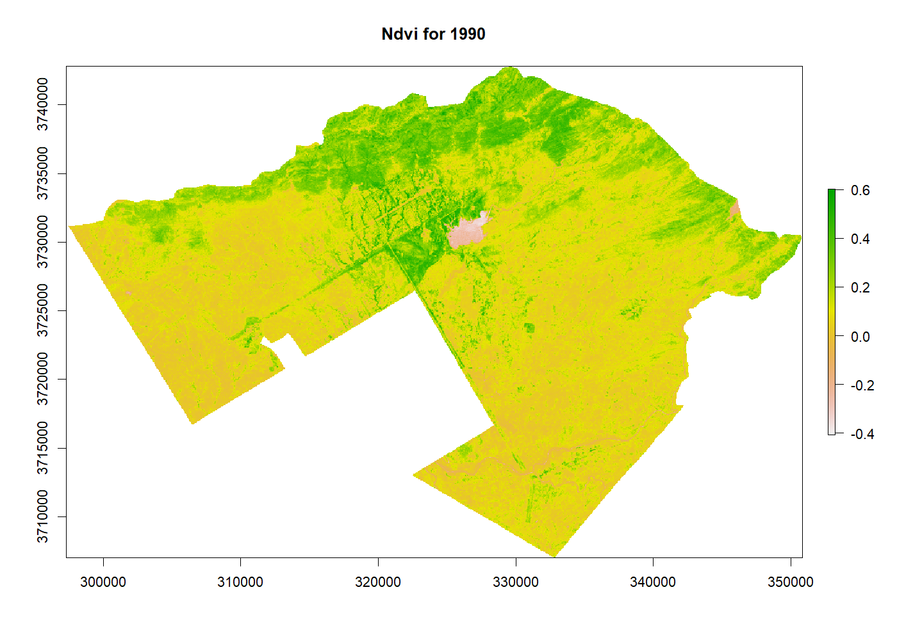
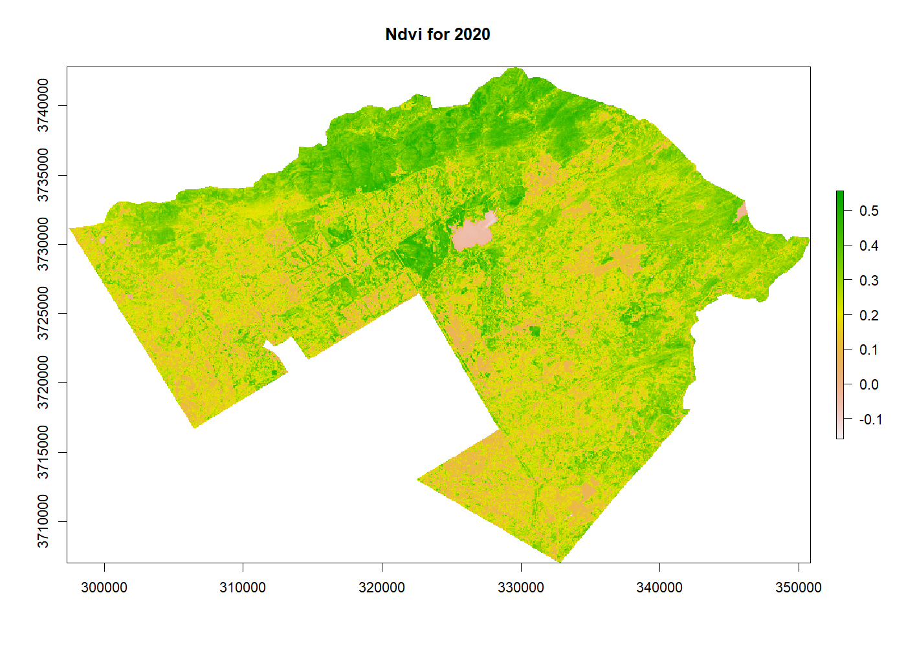
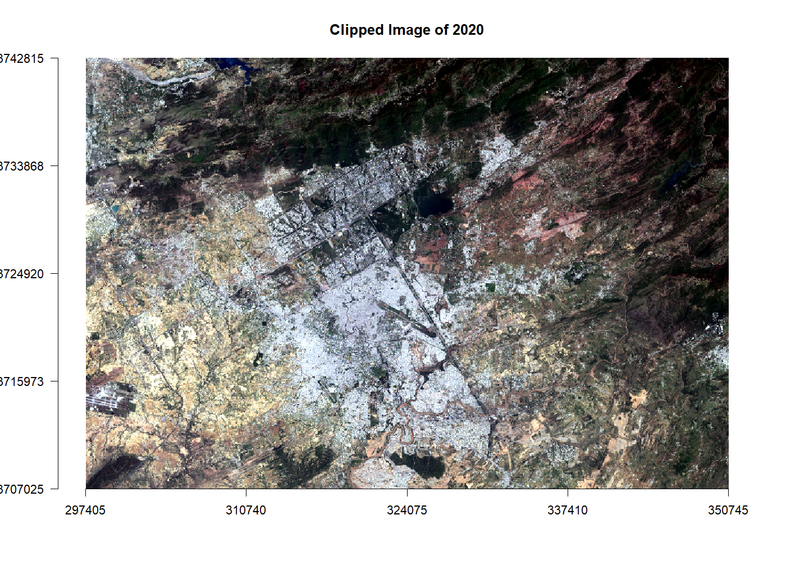
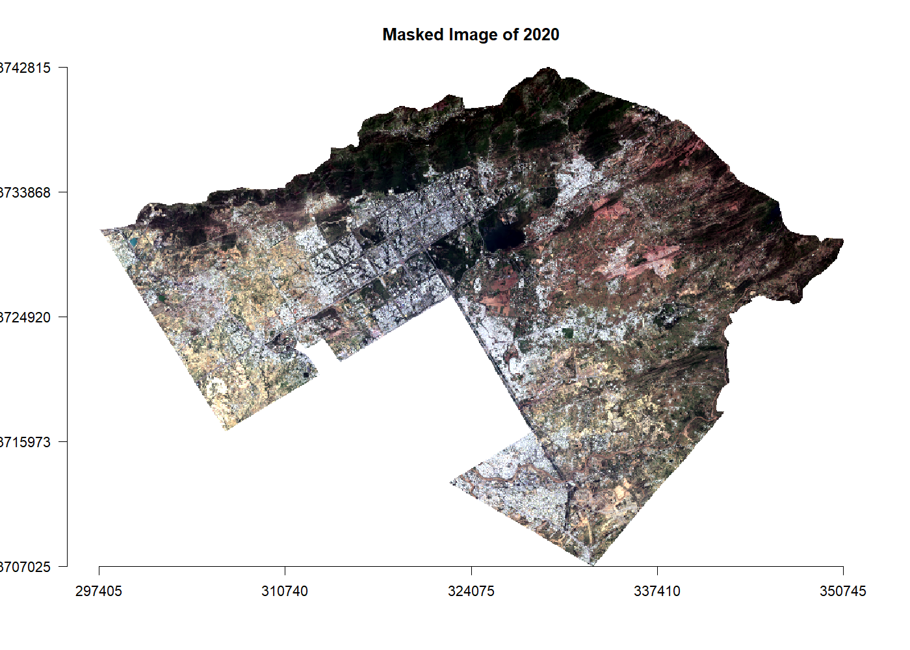
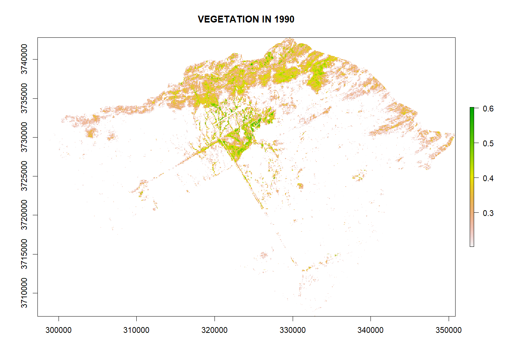
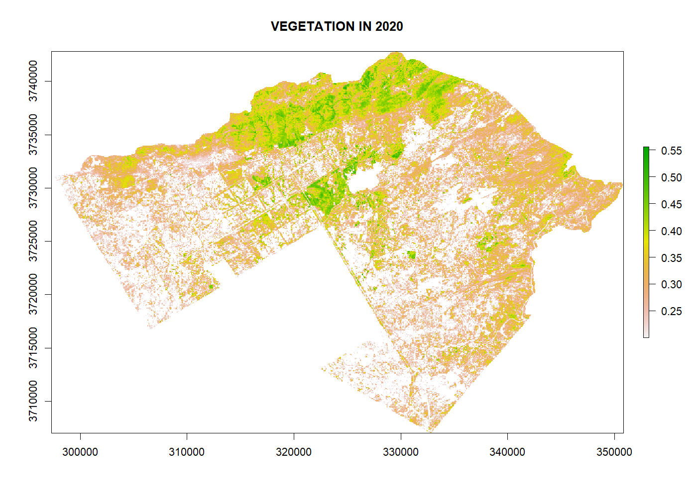
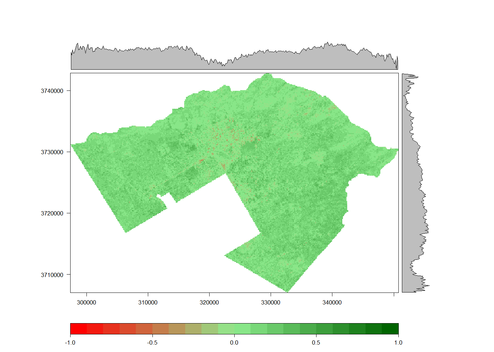

# Vegetation Change in Islamabad, 1990 vs. 2020 (NDVI with R)

An R script that compares **vegetation in Islamabad Capital Territory (ICT)** 30 years apart,
using a **Landsat 5** image from June 1990 and a **Landsat 8** image from June 2020 and the
**Normalised Difference Vegetation Index (NDVI)**.

Assignment for *Digital Image Processing*, BS Space Science, Institute of Space Technology (2021).
By **Muhammad Arbab Tahir**.

| NDVI 1990 | NDVI 2020 |
|---|---|
|  |  |

## What the script does

1. **Loads the Landsat bands** for both years and stacks them into one image per year.
2. **Clips and masks** each image to the exact ICT boundary.

   | True colour (2020) | Masked to the ICT boundary |
   |---|---|
   |  |  |

3. **Calculates NDVI** for each year:

   > NDVI = (NIR − Red) / (NIR + Red)

   | Satellite | Near-infrared (NIR) | Red |
   |---|---|---|
   | Landsat 5 TM (1990) | Band 4 | Band 3 |
   | Landsat 8 OLI (2020) | Band 5 | Band 4 |

4. **Maps vegetation**, counting pixels with **NDVI above 0.2** as vegetated.

   | Vegetation 1990 | Vegetation 2020 |
   |---|---|
   |  |  |

5. **Compares the two years** with a difference map (2020 − 1990), a box plot of the change and
   the vegetated area in each year.

   

## Results

| | 1990 | 2020 |
|---|---|---|
| Vegetated area (NDVI > 0.2) | 203 km² | 624 km² |

The vegetation is concentrated in the **Margalla Hills** in the north and along green belts and
parks in the city. The built-up city centre shows the lowest NDVI in both years.

> **Limitation:** NDVI here is calculated from **raw Level-1 pixel values (digital numbers)**.
> Landsat 5 and Landsat 8 record these on different scales: 8-bit vs. 16-bit, with different
> sensor calibrations. So the two years' NDVI values are **not directly comparable**. This is
> why NDVI looks higher almost everywhere in 2020, even in built-up areas. The maps show
> *where* vegetation is within each year reliably, but the size of the change between years is
> overstated. A fair comparison would use **Level-2 surface-reflectance** products for both
> years.

All 16 plots the script produces are in the [plots](plots/) folder.

## Data (included)

The two Landsat scenes from [USGS EarthExplorer](https://earthexplorer.usgs.gov/)
(Landsat Collection 2, Level-1), **cut down to the ICT area** (boundary plus a 2 km margin) at
full 30 m resolution, so they fit in this repository:

| Year | Satellite | Scene ID | Bands |
|---|---|---|---|
| 1990 (11 June) | Landsat 5 TM | `LT05_L1TP_150037_19900611_20200916_02_T1` | 1–7 |
| 2020 (29 June) | Landsat 8 OLI | `LC08_L1TP_150037_20200629_20200823_02_T1` | 1–7, 9 |

The ICT boundary shapefile is in [data/ICT_boundary](data/ICT_boundary/).

## How to run

1. Install R and these packages:
   ```r
   install.packages(c("raster", "sf", "RStoolbox", "ggplot2", "rasterVis"))
   ```
2. Download this repository, open R in its folder and run:
   ```r
   source("ndvi_change.R", print.eval = TRUE)
   ```
   The plots appear one after another in R's plot window.

## Built with
R · raster · sf · RStoolbox · rasterVis · ggplot2 · Landsat 5 & 8
